# Yalla: hang out on campus

A mobile-first social app for university students: **see where your friends are on a live campus map, start or join a hangout, chat in the group, and follow clubs.** Privacy comes first: everyone starts in *ghost mode*, and your location is only ever visible to mutual friends you chose.

Built for the Al Akhawayn University community in Ifrane, Morocco. It installs on a phone like an app (iPhone and Android) and runs on a free stack.

<p align="center">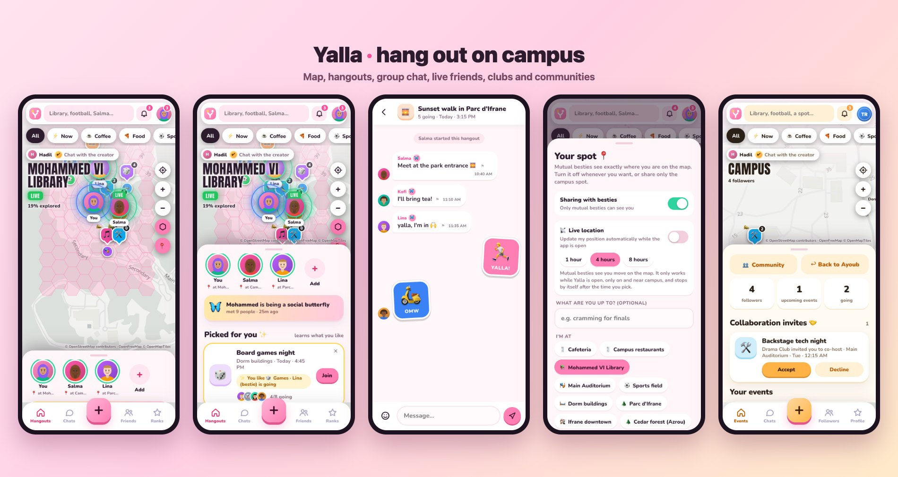</p>

## Try it

| | |
|---|---|
| **Demo, one click, no sign-up** | **https://yalla-afk.pages.dev/?demo** (sample students and clubs; everything stays in your browser) |
| **The real app** | https://yalla-afk.pages.dev (create an account; data lives in a real database shared by everyone) |
| **Put it on your phone** | Open the link in Safari (iPhone) or Chrome (Android) and choose **Add to Home Screen**. It opens full screen, like an app, and works offline. |

On a computer the app opens inside a phone-sized frame, so it looks the same everywhere.

## What it does

- **Live map** of campus in the style of the Bump app: friends as avatars, hangouts as pins, a hex "scratch map" that clears as you explore, and a route and ETA to a friend.
- **Hangouts and group chat.** Post a plan (coffee, football, study, hike), friends join, and the group gets a chat with stickers and private messages.
- **Besties and live location.** Mutual besties see each other on the map; GPS follows you while the app is open, for 1, 4 or 8 hours, then switches itself off. "Friend nearby" and "your bestie is going to..." alerts.
- **Ghost mode by default.** Hides your location and which events you join. Optional "share only the campus spot, not my exact position".
- **Clubs and communities.** Clubs post events to their followers, run a community (news, member chat, an ideas box with votes), show a photo gallery, have several starred heads, and can co-host events with other clubs.
- **A taste model.** "Picked for you" learns from what you join and ignore and explains every pick ("Lina, your bestie, is going").
- **Badges and ranks.** A single ✔ Creator badge, a 🦋 Butterfly badge earned by meeting people *and* using the app regularly, and tiers by how many people you have met.
- **Safety.** Report people, messages, events and clubs; block (in both directions, invisibly); a "who viewed my profile" list with private browsing; account deletion that is complete and **silent** (nobody is notified).

## Screens

<table>
<tr>
<td align="center">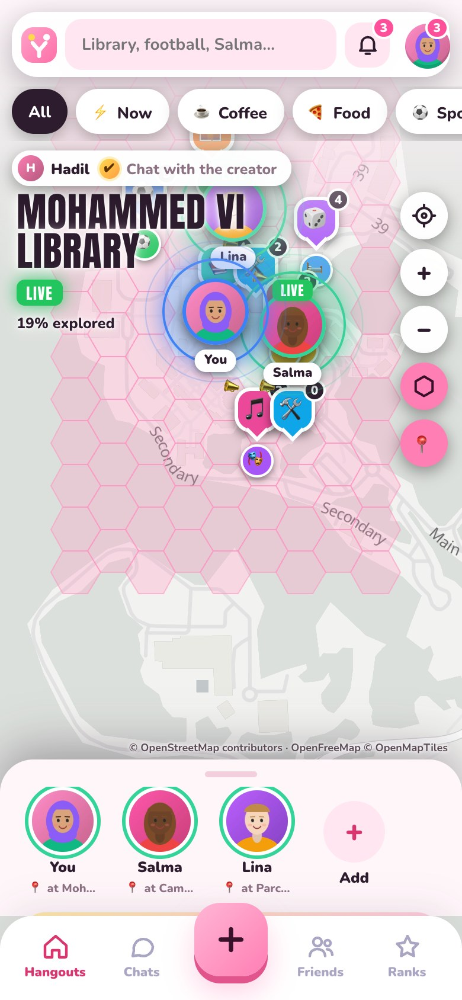<br><sub>Live campus map with friends, hangouts and the scratch map</sub></td>
<td align="center">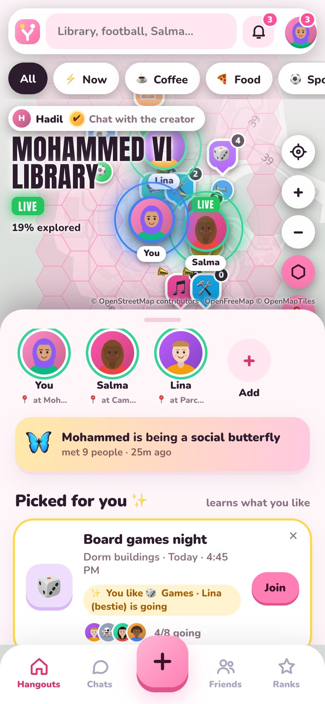<br><sub>Hangouts, with "Picked for you" and the reasons why</sub></td>
<td align="center">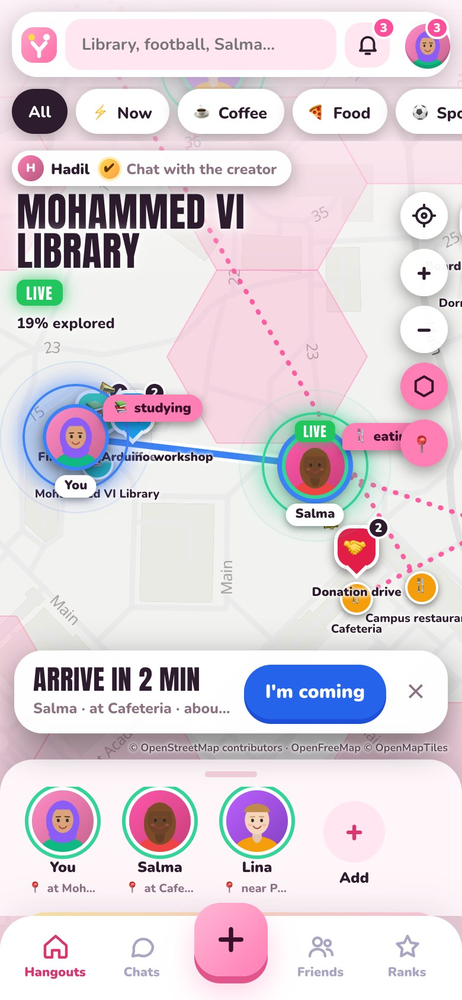<br><sub>Route and ETA to a friend</sub></td>
<td align="center">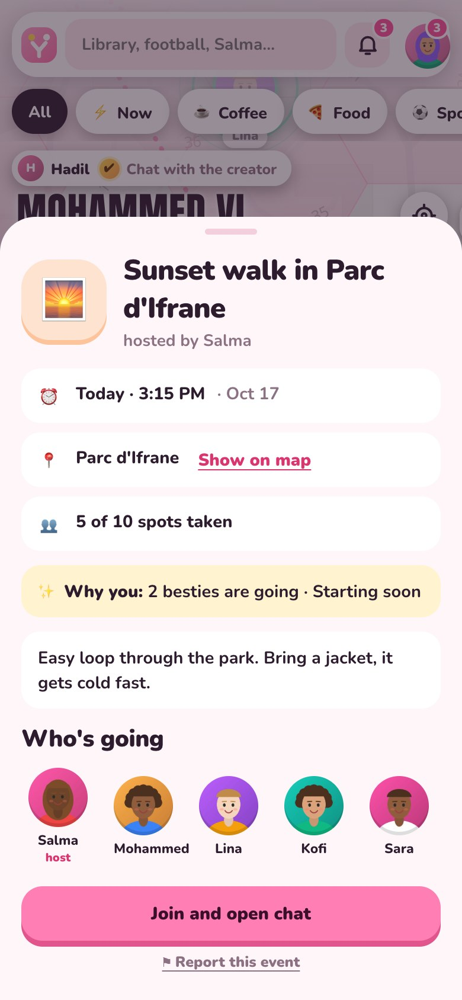<br><sub>A hangout: who is going, why it suits you</sub></td>
</tr>
<tr>
<td align="center">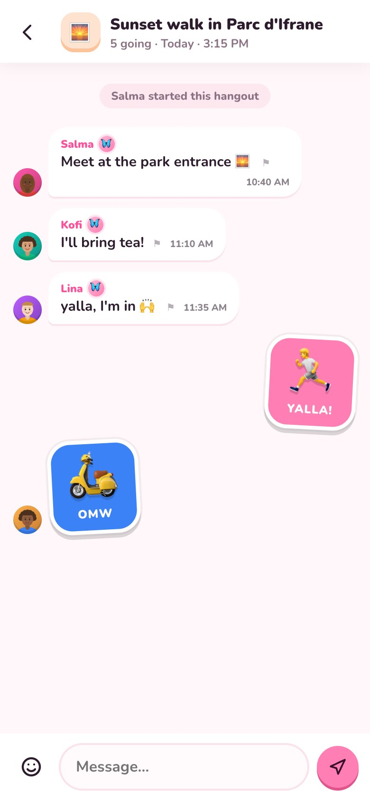<br><sub>Group chat with stickers</sub></td>
<td align="center">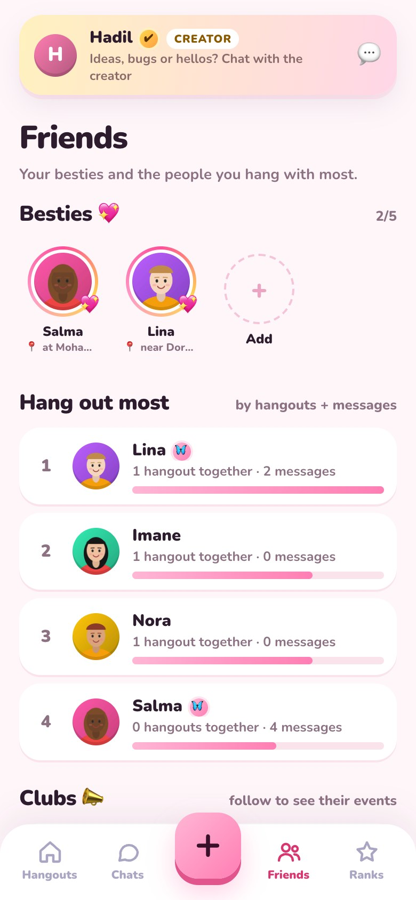<br><sub>Besties, most hung out with, clubs</sub></td>
<td align="center">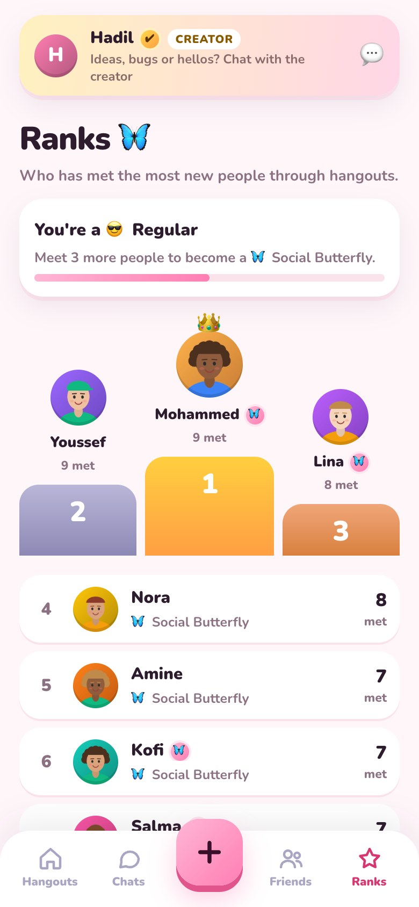<br><sub>Ranks and the Butterfly badge</sub></td>
<td align="center">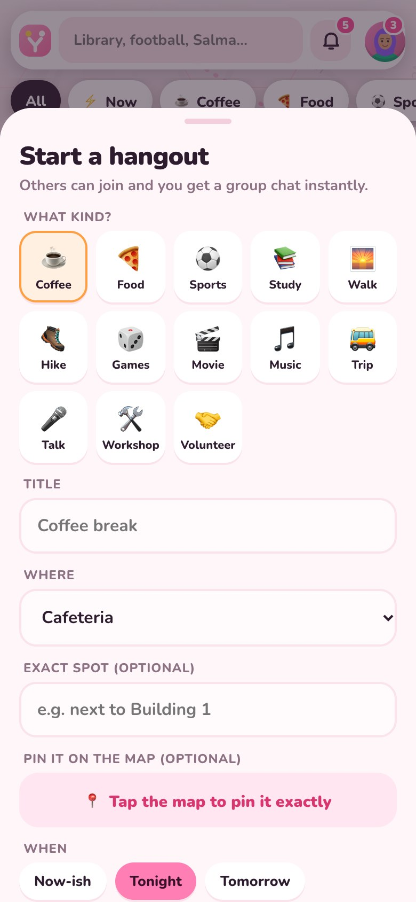<br><sub>Starting a hangout</sub></td>
</tr>
<tr>
<td align="center">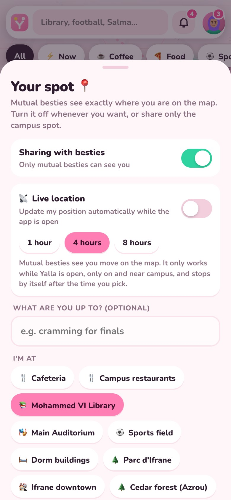<br><sub>Live location: 1, 4 or 8 hours, then it stops</sub></td>
<td align="center">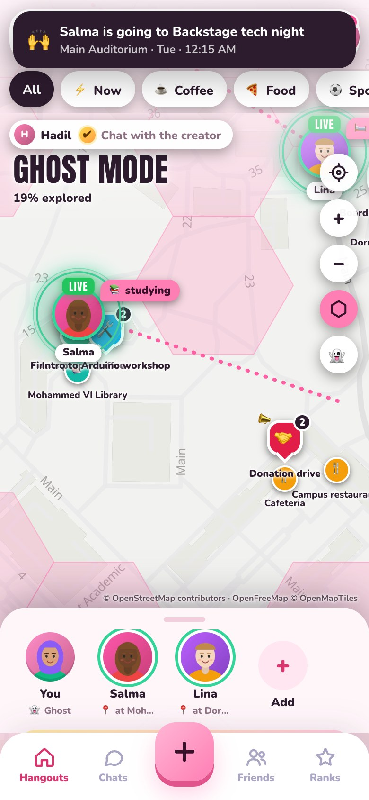<br><sub>Ghost mode: nobody sees you</sub></td>
<td align="center">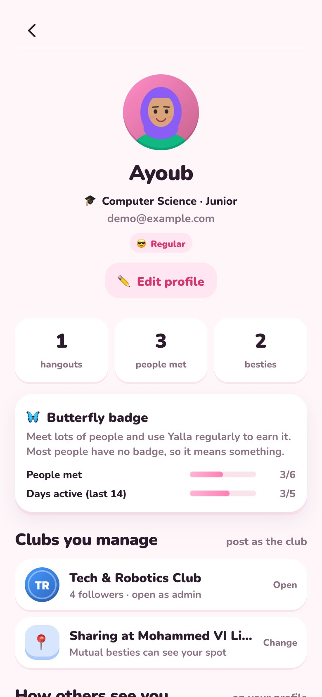<br><sub>Profile, badge progress, clubs you manage</sub></td>
<td align="center">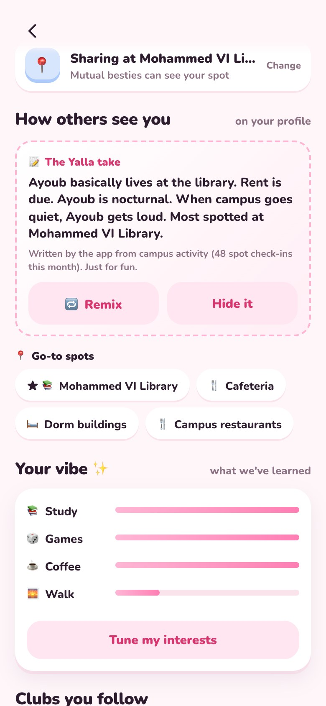<br><sub>"How others see you" and your taste</sub></td>
</tr>
<tr>
<td align="center">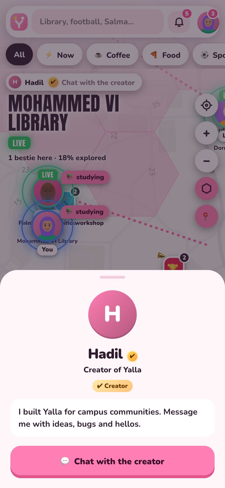<br><sub>The one ✔ Creator account</sub></td>
<td align="center">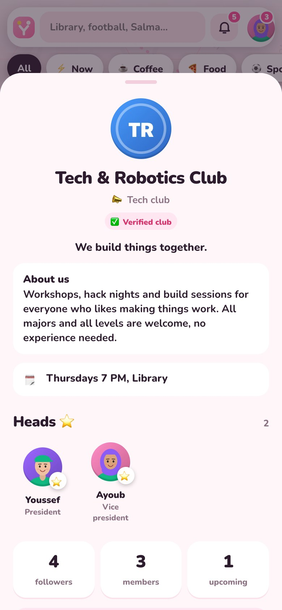<br><sub>A club: about, heads, followers</sub></td>
<td align="center">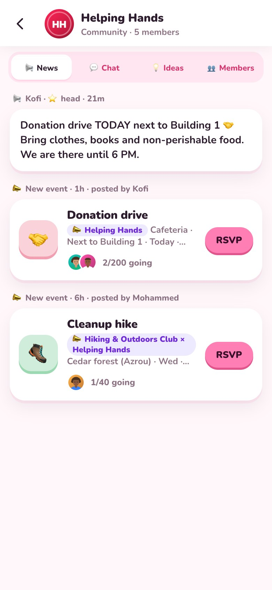<br><sub>A club community: news, chat, ideas</sub></td>
<td align="center">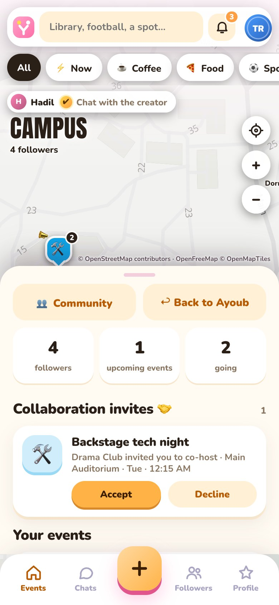<br><sub>A club's own orange dashboard, with a co-host invite</sub></td>
</tr>
<tr>
<td align="center">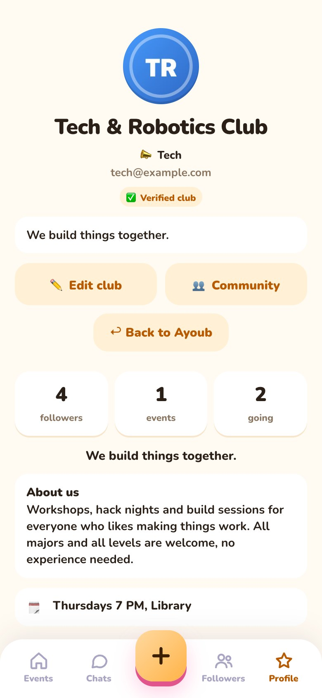<br><sub>Club profile and admin tools</sub></td>
<td align="center">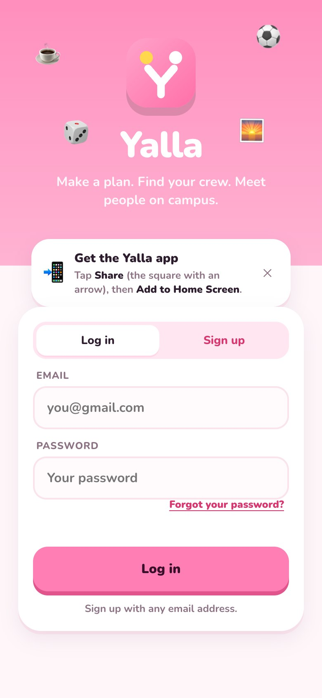<br><sub>Login, with the "install the app" card</sub></td>
<td align="center">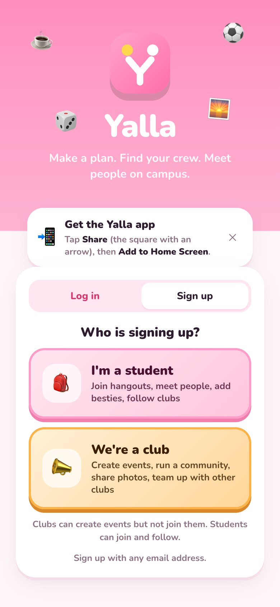<br><sub>Sign up as a student or as a club</sub></td>
<td align="center">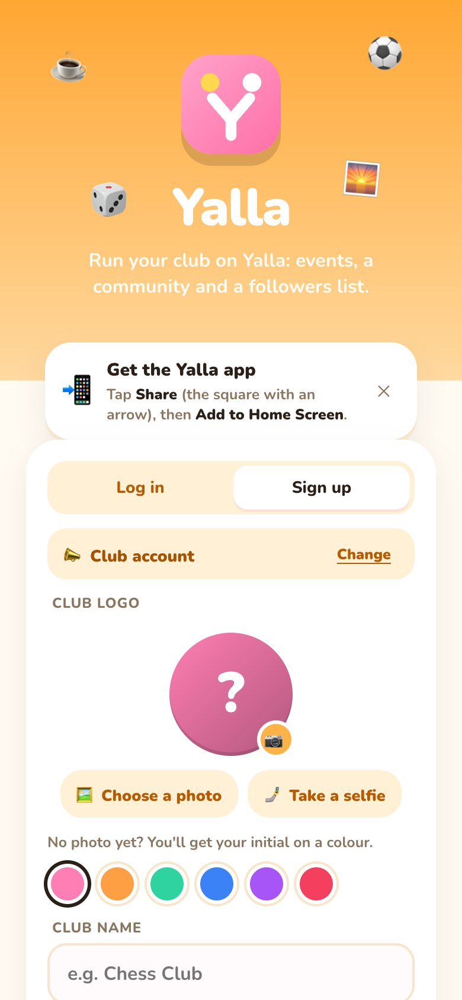<br><sub>Club sign-up</sub></td>
</tr>
</table>

## How it is built

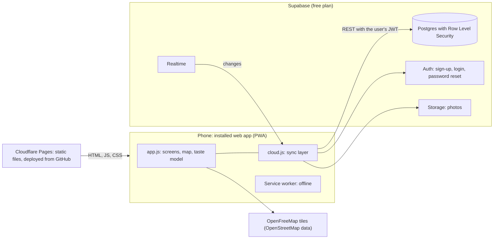

- **No build step.** Plain HTML, CSS and JavaScript (about 3,000 lines in `app.js`, 750 in `cloud.js`). Leaflet and MapLibre GL draw the map; the Supabase client talks to the backend. Libraries are vendored, so there is no CDN dependency at runtime.
- **Two modes from one codebase.** With `config.js` empty the app is a self-contained **demo** (seeded students who chat, walk around campus and join events). With a Supabase URL and public key it becomes the **real app**. `cloud.js` fills the app's in-memory data from the server and sends each action to the right table.
- **Free-tier aware.** The sync layer asks the server for a tiny fingerprint of "what changed" every few seconds and only downloads the big lists when it differs; realtime pushes changes, with polling as a fallback.
- **Continuous deployment.** Pushing to `main` triggers a Cloudflare Pages build that runs `scripts/make-deploy-folder.sh`, which assembles only the public files and **stops if it finds a secret key**.

## Privacy and security by design

The rules live in the database, not in the browser, so a modified client cannot get around them (`supabase/migrations/001_schema.sql`: 19 tables, 61 row level security policies, 43 functions).

| Rule | How it is enforced |
|---|---|
| Ghost mode is the default | `profiles.share_loc = false`; every location and attendee rule checks it; turning it on deletes your stored position |
| Location only for **mutual** besties, expiring, near campus | `locations` policy plus a trigger: 8 hours at most, within 3 km of campus |
| Private settings are invisible to everyone else | Column-level grants; only `my_settings()` returns your own switches |
| The app can never grant itself badges, notifications or system messages | Those columns have no write permission for browsers; triggers write them |
| Blocking works both ways and the blocked person is never told | `is_blocked()` inside every policy; `blocks` readable only by the blocker |
| Account deletion is silent and complete | `delete_my_account()`: cascade delete, no notification is created for anyone; reports about the person stay, without their content |
| Sign-up requires the 16+ and terms confirmation | Enforced in the database trigger, not only in the form |

## Tests

**303 automated checks**, all passing, including attempts to break the rules (stealing the Creator badge, reading a stranger's location, joining a club event as a non-follower, forging a system message):

- `supabase/tests/run-tests.sh`: 230 checks against a throwaway Postgres, acting as different users.
- `supabase/tests/run-rest-tests.sh`: 73 checks through PostgREST with the real Supabase client. It also runs **every query found in `cloud.js`**, so the app and the schema cannot drift apart.
- `supabase/tests/dev-stack.sh`: a local test backend (Postgres, PostgREST and a small fake of the login and storage services) so the real UI can be driven in a browser without any account.

The tests found real mistakes that code review had missed: a new event that could not be read back after creating it, a location save refused by a column lock, a notification leak for blocked people, and a privacy gap in profile columns.

## Run it locally

```bash
python3 serve.py          # http://localhost:5173 , demo mode, no build, no account
```

Real mode needs a free Supabase project: see [docs/SETUP-SUPABASE.md](docs/SETUP-SUPABASE.md). Hosting and phone installs: [docs/LAUNCH.md](docs/LAUNCH.md). How everything works and what is still to do: [docs/DEVELOPMENT.md](docs/DEVELOPMENT.md), [docs/NEXT-STEPS.md](docs/NEXT-STEPS.md).

## Status and honest limits

Working end to end and ready for a campus pilot. Known limits:

- **Location works only while the app is open.** A web app cannot track in the background; that would need a native app and an Apple Developer account ($99 a year). Installing from the home screen is the free route on iPhone.
- **Push notifications are not built yet** (alerts appear inside the app).
- **Sign-up is open** and email confirmation is off for the pilot; a free email sender needs a domain, so confirmation is the next step before a public launch.
- The privacy policy and terms are a template and need a lawyer's review before a wide launch.

## Credits

Map data © OpenStreetMap contributors, tiles by OpenFreeMap. Libraries: Leaflet, MapLibre GL JS, supabase-js. Developed with [Claude Code](https://claude.com/claude-code) as an AI pair programmer; product decisions, testing and deployment by the author.

**Author:** Hadil Chafik, AI & Computer Engineering student at Al Akhawayn University · [GitHub @hadilch2004](https://github.com/hadilch2004) · [LinkedIn](https://www.linkedin.com/in/hadil-chafik-779a86249/)
